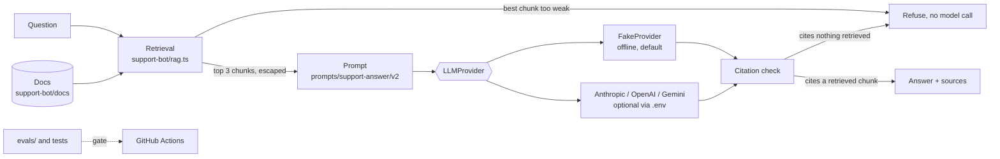

# ai-agent-workflows

[](https://github.com/dc-tech-inc/ai-agent-workflows/actions/workflows/ci.yml)
[](LICENSE)

Engineering reference by [DCtech.](https://dctech.live): how to build an LLM feature so that it can be tested, evaluated and swapped, in strict TypeScript. It contains a versioned prompt library, offline evals that gate CI, a retrieval-augmented support bot, example agent configs for Claude Code, Codex and Gemini CLI, and a client example that consumes the [`mcp-tool-server`](https://github.com/dc-tech-inc/mcp-tool-server) from this account.

Everything runs offline by default, with no API key. A real model is optional and has **not** been run against this repository (see [Limitations](#limitations)).

## The problem

Most LLM demos cannot be tested: they need a key, the answers change on every run, and a prompt edit can break behaviour without any signal. This repository shows one way around that, with the model behind a small interface, prompts as versioned files, and evals that run in CI.

## Architecture



## What is inside

| Folder | What it is |
|---|---|
| `prompts/` | Prompt library: `prompts/<name>/v<N>.md`, front matter, a loader that rejects undeclared or missing variables ([ADR 5](docs/adr/0005-versioned-prompt-files-with-contracts.md)) |
| `evals/` | 22 deterministic cases plus prompt-contract checks; `pnpm evals` exits non-zero below a threshold |
| `support-bot/` | CLI support bot over a fictional product's docs: retrieval, refusal, citation check ([ADR 3](docs/adr/0003-lexical-retrieval-no-vector-db.md)) |
| `src/llm/` | `LLMProvider`, the offline `FakeProvider`, and optional Anthropic/OpenAI/Gemini adapters on plain `fetch` ([ADR 1](docs/adr/0001-offline-fake-llm-by-default.md), [ADR 2](docs/adr/0002-plain-fetch-no-vendor-sdks.md)) |
| `agent-configs/` | Generic `CLAUDE.md`, `AGENTS.md`, `GEMINI.md`, a Claude Code settings file, a `PreToolUse` deny-list hook, and slash commands |
| `examples/mcp-client/` | MCP client for `mcp-tool-server` plus converters from MCP tool schemas to the three vendors' tool formats ([ADR 4](docs/adr/0004-consume-mcp-tool-server.md)) |

## Run it

Requirements: Node.js 24 and pnpm 11.

```bash
pnpm install
pnpm bot "How much does the Family plan cost?"   # one question; no argument starts a prompt loop
pnpm evals                                       # offline evals
pnpm test                                        # unit tests
```

Real output from this repository (`fake` provider; the header line is omitted and the first answer is one line, wrapped here):

```text
$ pnpm bot "How much does the Family plan cost?"
The Family plan costs 9 dollars per month and includes 1 TB of shared storage for up to 5 users. [plans-and-pricing#2]
The Personal plan costs 4 dollars per month and includes 200 GB of storage for one user. [plans-and-pricing#1]
sources: plans-and-pricing#2, plans-and-pricing#1, plans-and-pricing#3

$ pnpm bot "What is the capital of France?"
I could not find that in the documentation, so I would rather not guess.
```

The answer repeats a second, less relevant sentence because the fake model is extractive. A real model would write one answer.

## Evals

`pnpm evals` result on the offline provider (the same command CI runs):

| Metric | Result | Minimum |
|---|---|---|
| Retrieval hit@3 (18 questions) | 1.00 | 0.90 |
| Retrieval MRR | 1.00 | 0.80 |
| Answer contains the expected fact | 0.94 (17 of 18) | 0.90 |
| Answer cites an expected source | 1.00 | 0.90 |
| Out-of-scope questions refused (4, one is a prompt-injection attempt) | 1.00 | 1.00 |
| Prompt contracts | 1.00 | 1.00 |

The one miss is real: for "What does error FB-204 mean?" the extractive fake returns the neighbouring FB-310 sentence instead of the one with the fix. I left it in rather than tune the fake until it scored 18 of 18. The first run of these evals scored much lower; they found a prompt-parsing bug in the fake provider and a retrieval weakness (hash collisions made unrelated questions look relevant), both fixed before the first commit.

**What these numbers are not:** they measure the pipeline around a model, using a stand-in model. They say nothing about how Claude, GPT or Gemini would score. `pnpm evals --live` runs the same cases against the provider in your `.env`.

## Using a real model (optional)

```bash
cp .env.example .env     # then set LLM_PROVIDER, LLM_API_KEY and LLM_MODEL
pnpm bot
pnpm evals --live
```

`.env` is git-ignored. There is deliberately no default model id: pick one from the vendor's current list.

## MCP integration

`examples/mcp-client` starts the `mcp-tool-server` over stdio, lists its tools and calls `hygiene_check`:

```bash
git clone https://github.com/dc-tech-inc/mcp-tool-server && cd mcp-tool-server && pnpm install && pnpm build && cd ..
MCP_TOOL_SERVER_DIST="$PWD/mcp-tool-server/dist/index.js" pnpm mcp-example ./mcp-tool-server
```

CI does the same at a pinned commit and runs `test/mcp.test.ts` against the live process. No second MCP server is written here on purpose.

## Agent configs

`agent-configs/` holds starting points, not a product: copy what you need and edit it.

| File | Tool | Notes |
|---|---|---|
| `claude/CLAUDE.md`, `claude/commands/*.md`, `claude/settings.json`, `claude/hooks/block-destructive.ts` | Claude Code | The hook denies recursive deletes of `/` or `~`, force pushes, `git reset --hard`, `curl \| sh`, `chmod -R 777` and `DROP DATABASE`, and is unit-tested. It is a seatbelt, not a sandbox. |
| `codex/AGENTS.md` | Codex CLI and other tools that read `AGENTS.md` | |
| `gemini/GEMINI.md`, `gemini/commands/review.toml` | Gemini CLI | |

The formats follow the vendor documentation listed below. The files were not exercised inside those tools by this repository's CI.

## Limitations

- **A real LLM has not been tested.** The Anthropic, OpenAI and Gemini adapters are checked against the documented request and response shapes with an injected `fetch`, never against the live services. Expect to debug first contact.
- The offline model is extractive. It is a test double, not a demo of answer quality.
- Retrieval matches words, not meaning ([ADR 3](docs/adr/0003-lexical-retrieval-no-vector-db.md)). The corpus is fictional (a made-up backup product) and tiny.
- The prompt-injection eval is only meaningful with a real model; offline it mostly confirms the bot refuses off-topic input and that retrieved text is escaped before it reaches the prompt.
- No streaming, retries, rate limiting, tool-calling loop or conversation memory. No web UI.
- CI runs on Linux only.

## Official documentation used

- Anthropic Messages API: <https://docs.anthropic.com/en/api/messages>
- OpenAI Chat Completions API: <https://platform.openai.com/docs/api-reference/chat>
- Gemini `generateContent`: <https://ai.google.dev/api/generate-content>
- Model Context Protocol SDKs: <https://modelcontextprotocol.io/docs/sdk> and <https://github.com/modelcontextprotocol/typescript-sdk>
- Claude Code memory (`CLAUDE.md`): <https://code.claude.com/docs/en/memory>, hooks: <https://code.claude.com/docs/en/hooks>, slash commands: <https://code.claude.com/docs/en/slash-commands>
- `AGENTS.md`: <https://agents.md>
- Gemini CLI `GEMINI.md`: <https://github.com/google-gemini/gemini-cli/blob/main/docs/cli/gemini-md.md>
- Prompt engineering guide (Anthropic): <https://docs.anthropic.com/en/docs/build-with-claude/prompt-engineering/overview>

## Roadmap

Tracked as issues: a tool-calling agent loop on top of the MCP client, an embedding-based retriever behind the same interface, and a recorded `--live` run published once someone with a key has made one.

## Contributing and security

See [CONTRIBUTING.md](CONTRIBUTING.md) and [SECURITY.md](SECURITY.md). Licensed under the [MIT License](LICENSE).
